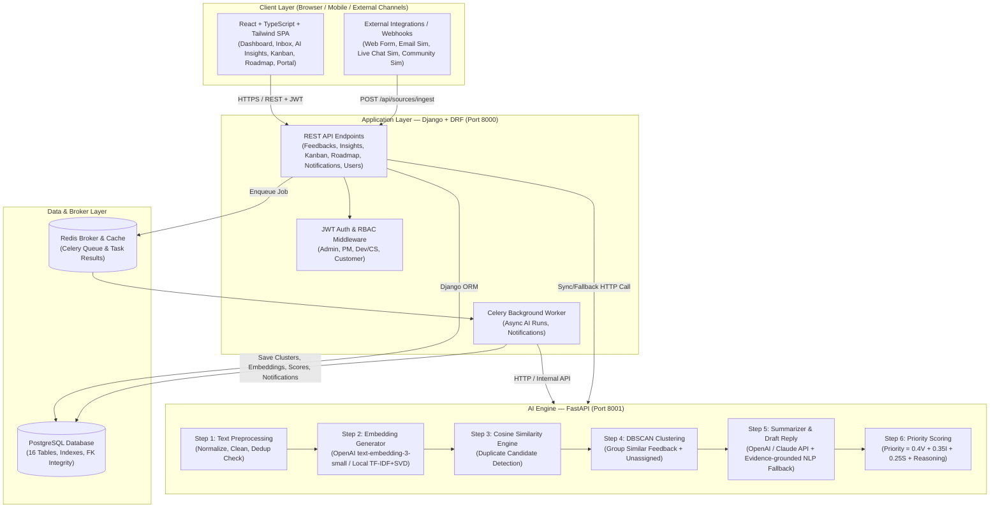

# Kiến Trúc Hệ Thống — InsightHub AI

## 1. Tổng Quan Nghiệp Vụ

**InsightHub AI** là nền tảng SaaS quản lý Product Feedback & Product Discovery ứng dụng AI dành cho đội ngũ Product Manager, Customer Support, Developer và Khách hàng.

Hệ thống giải quyết bài toán thực tế:
- Doanh nghiệp tiếp nhận hàng loạt phản hồi từ nhiều kênh rời rạc (**Website Form**, **Email**, **Live Chat**, **Cộng đồng**).
- Dữ liệu phản hồi thường bị phân mảnh, trùng lặp nội dung, khó định lượng mức độ ảnh hưởng.
- Đội Product mất nhiều thời gian phân loại thủ công và thiếu căn cứ định lượng khi quyết định ưu tiên lên **Kanban** và **Product Roadmap**.

InsightHub AI chuẩn hóa toàn bộ luồng từ **Multi-source Ingestion → AI Clustering & Scoring → PM Verification → Kanban Workflow → Public/Private Roadmap → Customer Notification**.

---

## 2. Sơ Đồ Kiến Trúc Tổng Thể

---

## 3. Phân Tách Trách Nhiệm Các Thành Phần

### 3.1 Frontend (`frontend/`)
- **Framework**: React 18 + TypeScript + Vite.
- **Styling**: Tailwind CSS theo phong cách Linear / Notion (sidebar cố định, top bar tìm kiếm/thông báo, responsive desktop/tablet/mobile).
- **Visualization**: Recharts (Area/Line chart theo thời gian, Bar/Pie chart theo nguồn và mức ưu tiên).
- **State & HTTP**: Axios interceptor tự động gắn Bearer JWT, refresh token khi hết hạn, xử lý loading/empty/error states rõ ràng.

### 3.2 Backend Core (`backend/`)
- **Framework**: Django 5 + Django REST Framework + SimpleJWT.
- **Nhiệm vụ**:
  - Quản lý người dùng, phân quyền RBAC ở tầng API (`ADMIN`, `PRODUCT_MANAGER`, `DEVELOPER`, `CUSTOMER_SUPPORT`, `CUSTOMER`).
  - Lưu trữ thống nhất tất cả nguồn feedback vào PostgreSQL (`feedbacks` + `feedback_sources`).
  - Điều phối AI analysis (qua Celery worker khi Redis sẵn sàng, hoặc thực thi đồng bộ an toàn khi không bật worker).
  - Quản lý Kanban workflow, audit `activity_logs`, `notifications`, và tách dữ liệu **Public Roadmap** vs **Private Roadmap** nghiêm ngặt trên backend.

### 3.3 AI Microservice (`ai_service/`)
- **Framework**: FastAPI + Pydantic + NumPy + scikit-learn + OpenAI / Anthropic SDK.
- **Nhiệm vụ**:
  - Tách biệt hoàn toàn tác vụ tính toán vector/clustering/LLM khỏi Django web thread.
  - Có hai chế độ hoạt động minh bạch:
    1. **LLM + Embedding Cloud Mode** (khi cấu hình `OPENAI_API_KEY` hoặc `ANTHROPIC_API_KEY`): sử dụng `text-embedding-3-small` + GPT/Claude API với prompt ràng buộc chỉ dựa trên bằng chứng feedback.
    2. **Local ML/NLP Mode** (mặc định khi chưa gắn API key trả phí, hoặc fallback khi key lỗi): sử dụng TF-IDF (word + char_wb n-grams tiếng Việt/Anh) + TruncatedSVD L2-normalized dense embeddings, Cosine Similarity thực sự, DBSCAN clustering thực sự, trích xuất cụm từ khóa & feedback đại diện (centroid), và tính công thức `0.4V + 0.35I + 0.25S` kèm giải thích định lượng.

### 3.4 Database & Background Jobs
- **PostgreSQL**: Lưu trữ toàn bộ dữ liệu nghiệp vụ, embeddings, cấu hình nguồn, lịch sử thay đổi và thông báo.
- **Redis + Celery**: Thực thi pipeline AI bất đồng bộ cho tập dữ liệu lớn và ghi nhận trạng thái job trong bảng `ai_analysis_jobs`.

---

## 4. Ma Trận Phân Quyền RBAC (Backend Enforced)

| Chức năng / Resource | ADMIN | PRODUCT_MANAGER | DEVELOPER / CS | CUSTOMER |
|---|:---:|:---:|:---:|:---:|
| Quản lý Users & Roles | Toàn quyền | Chỉ xem danh sách assign | Chỉ xem danh sách cơ bản | Không |
| Quản lý Products & Sources | Toàn quyền | Xem & chỉnh sửa | Chỉ xem | Chỉ xem Products công khai |
| Gửi Feedback (Portal / Multi-source) | Có | Có | Có | Có |
| Xem danh sách Feedback | Tất cả | Tất cả | Được phân công hoặc trong insight được cấp quyền | Chỉ của bản thân |
| Sửa / Gán / Xóa Feedback | Toàn quyền | Tạo / Sửa / Gán / Merge | Cập nhật trạng thái & comment nội bộ trên item được giao | Sửa nội dung của mình khi trạng thái `NEW` |
| Chạy AI Pipeline & Quản lý Insight | Toàn quyền | Toàn quyền (Confirm/Reject/Merge/Split/Override Score) | Xem insight liên quan & comment nội bộ | Không |
| Quản lý Kanban Board | Toàn quyền | Toàn quyền (Drag-drop, Assign, Deadline) | Cập nhật cột trạng thái item được giao & comment | Không |
| Quản lý Roadmap (Private) | Toàn quyền | Toàn quyền (Tạo từ Insight, Sửa, Tiến độ) | Chỉ xem Private & Public | Không |
| Xem Public Roadmap | Có | Có | Có | Có (ẩn thông tin nội bộ) |
| Thông báo (Notifications) | Hệ thống | Toàn đội Product | Liên quan đến item được giao | Chỉ liên quan đến feedback của mình |
