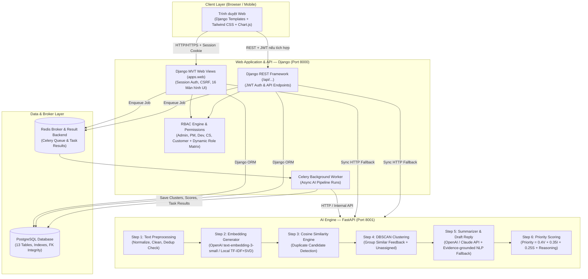

# Kiến Trúc Hệ Thống — InsightHub AI

## 1. Tổng Quan Nghiệp Vụ

**InsightHub AI** là nền tảng SaaS quản lý Product Feedback & Product Discovery thuần Python ứng dụng AI dành cho đội ngũ Product Manager, Customer Support, Developer và Khách hàng.

Hệ thống giải quyết bài toán thực tế:
- Doanh nghiệp tiếp nhận hàng loạt phản hồi từ nhiều kênh rời rạc (**Website Form**, **Email**, **Live Chat**, **Cộng đồng**).
- Dữ liệu phản hồi thường bị phân mảnh, trùng lặp nội dung, khó định lượng mức độ ảnh hưởng.
- Đội Product mất nhiều thời gian phân loại thủ công và thiếu căn cứ định lượng khi quyết định ưu tiên lên **Kanban** và **Product Roadmap**.

InsightHub AI chuẩn hóa toàn bộ luồng từ **Multi-source Ingestion → AI Clustering & Scoring → PM Verification → Kanban Workflow → Public/Private Roadmap → Customer Notification**.

---

## 2. Sơ Đồ Kiến Trúc Tổng Thể

---

## 3. Phân Tách Trách Nhiệm Các Thành Phần

### 3.1 Web UI (`backend/apps/web/` & `backend/templates/`)
- **Framework**: Django Templates (Server-side Rendering thuần Python, thay thế cho React/Next.js).
- **Styling & Visualization**: Tailwind CSS + Lucide Icons + Chart.js (Area/Line chart theo thời gian, Doughnut chart theo nguồn, Bar chart theo trạng thái/tag/mức ưu tiên).
- **Tương tác nâng cao**: Drag-and-drop Kanban Board, toggle bảng phân quyền chức năng động bằng AJAX + CSRF token, polling trạng thái Celery task (`/insights/ai-task/<task_id>/`).

### 3.2 Backend Core & REST API (`backend/`)
- **Framework**: Django 6 + Django REST Framework + SimpleJWT + WhiteNoise + Gunicorn.
- **Nhiệm vụ**:
  - Quản lý người dùng, phân quyền RBAC động (`Role.permissions` + `apps/accounts/permissions.py` + `apps/web/decorators.py`).
  - Lưu trữ thống nhất tất cả nguồn feedback vào PostgreSQL (`feedbacks` + `feedback_sources`).
  - Điều phối AI analysis (qua Celery worker khi Redis sẵn sàng, hoặc thực thi đồng bộ an toàn khi `CELERY_ENABLED=False`).
  - Quản lý Kanban workflow 4 cột (`NEW`, `REVIEWING`, `PLANNED`, `DONE`), `notifications`, và tách dữ liệu **Public Roadmap** vs **Private Roadmap** nghiêm ngặt trên backend.

### 3.3 AI Microservice (`ai_service/`)
- **Framework**: FastAPI + Pydantic + NumPy + scikit-learn + OpenAI / Anthropic SDK.
- **Nhiệm vụ**:
  - Tách biệt hoàn toàn tác vụ tính toán vector/clustering/LLM khỏi Django web thread.
  - Có hai chế độ hoạt động minh bạch:
    1. **LLM + Embedding Cloud Mode** (khi cấu hình `OPENAI_API_KEY` hoặc `ANTHROPIC_API_KEY`).
    2. **Local ML/NLP Mode** (mặc định khi chưa gắn API key trả phí, hoặc fallback khi key lỗi): sử dụng TF-IDF (word + concept + char_wb n-grams) + TruncatedSVD L2-normalized dense embeddings, Cosine Similarity, DBSCAN clustering, trích xuất từ khóa và tính công thức `0.4V + 0.35I + 0.25S`.

### 3.4 Database & Background Jobs
- **PostgreSQL**: Lưu trữ toàn bộ 13 bảng dữ liệu nghiệp vụ, cấu hình nguồn, nhóm insight, roadmap và thông báo.
- **Redis + Celery**: Thực thi pipeline AI bất đồng bộ cho tập dữ liệu lớn khi bật `CELERY_ENABLED=True` kèm endpoint `/api/ai/tasks/<task_id>/` để theo dõi kết quả.

---

## 4. Ma Trận Phân Quyền RBAC Mặc Định (Backend Enforced)

Ngoài ma trận mặc định dưới đây, **Admin** có thể bật/tắt động 8 module chức năng (`dashboard`, `inbox`, `sources`, `insights`, `ai_run`, `kanban`, `roadmap`, `users`) cho từng vai trò ngay trên trang `/users/`.

| Chức năng / Resource | ADMIN | PRODUCT_MANAGER | DEVELOPER / CS | CUSTOMER |
|---|:---:|:---:|:---:|:---:|
| Quản lý Users & Phân quyền động | Toàn quyền | Xem danh bạ | Xem danh bạ | Không |
| Quản lý Products & Tags | Toàn quyền | Toàn quyền | Chỉ xem | Chỉ xem Products công khai |
| Gửi Feedback (Portal / Multi-source) | Có | Có | Có | Có (Portal) |
| Xem danh sách Feedback | Tất cả | Tất cả | Dev: được phân công; CS: tất cả | Chỉ của bản thân |
| Sửa / Gán / Xóa Feedback | Toàn quyền | Tạo / Sửa / Gán / Xóa | Cập nhật trạng thái, tag (CS được gán) | Sửa/xóa của mình khi `NEW` |
| Chạy AI Pipeline & Quản lý Insight | Toàn quyền | Toàn quyền (Confirm/Reject/Merge/Split/Priority) | Xem insight liên quan (nếu có quyền) | Không |
| Quản lý Kanban Board | Toàn quyền | Toàn quyền (4 cột) | Cập nhật item được phân công | Không |
| Quản lý Roadmap (Private) | Toàn quyền | Toàn quyền (Tạo/Sửa/Xóa) | Chỉ xem Private & Public | Không |
| Xem Public Roadmap | Có | Có | Có | Có (ẩn thông tin nội bộ) |
| Thông báo (Notifications) | Cá nhân | Toàn đội Product | Cá nhân & item được gán | Chỉ phản hồi của mình / Public Roadmap |
