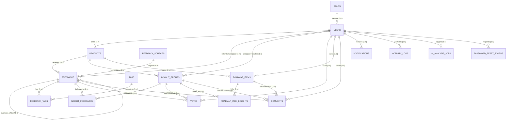

# Thiết Kế Cơ Sở Dữ Liệu (PostgreSQL) & ERD — InsightHub AI

## 1. Sơ Đồ Quan Hệ Thực Thể (ERD)

---

## 2. Chi Tiết Các Bảng (16 Bảng PostgreSQL)

### 2.1 `roles`
- **PK**: `id` (`BIGSERIAL`)
- **Columns**: `code` (`VARCHAR(32)`, UNIQUE: `ADMIN`, `PRODUCT_MANAGER`, `DEVELOPER`, `CUSTOMER_SUPPORT`, `CUSTOMER`), `name`, `description`, `permissions` (`JSONB`), `created_at`.

### 2.2 `users`
- **PK**: `id` (`BIGSERIAL`)
- **FK**: `role_id -> roles(id)` (`ON DELETE PROTECT`)
- **Columns**: `username` (UNIQUE), `email` (UNIQUE, indexed), `password` (PBKDF2-SHA256 hash), `full_name`, `job_title`, `department`, `avatar_url`, `email_notifications_enabled`, `is_active`, `is_staff`, `is_superuser`, `date_joined`, `updated_at`.

### 2.3 `products`
- **PK**: `id` (`BIGSERIAL`)
- **FK**: `owner_id -> users(id)` (`ON DELETE SET NULL`)
- **Columns**: `name`, `slug` (UNIQUE), `description`, `category`, `is_active`, `created_at`, `updated_at`.

### 2.4 `feedback_sources`
- **PK**: `id` (`BIGSERIAL`)
- **Columns**: `code` (UNIQUE: `WEB_FORM`, `EMAIL`, `LIVE_CHAT`, `COMMUNITY`), `name`, `channel_type`, `description`, `webhook_token` (indexed), `is_active`, `created_at`.

### 2.5 `feedbacks`
- **PK**: `id` (`BIGSERIAL`)
- **FK**:
  - `author_id -> users(id)` (`ON DELETE SET NULL`)
  - `product_id -> products(id)` (`ON DELETE CASCADE`)
  - `source_id -> feedback_sources(id)` (`ON DELETE PROTECT`)
  - `assigned_to_id -> users(id)` (`ON DELETE SET NULL`)
  - `duplicate_of_id -> feedbacks(id)` (`ON DELETE SET NULL`, self-referencing)
- **Columns**: `code` (UNIQUE `FB-0001`), `title`, `content`, `normalized_content`, `embedding` (`JSONB`), `embedding_model`, `sender_name`, `sender_email`, `external_reference_id`, `source_metadata` (`JSONB`), `status` (`NEW`, `TRIAGING`, `ANALYZING`, `PLANNED`, `IN_PROGRESS`, `COMPLETED`, `CLOSED`, `DUPLICATE`), `impact_level` (`LOW`, `MEDIUM`, `HIGH`, `CRITICAL`), `priority_score` (`DOUBLE PRECISION`), `similarity_score` (`DOUBLE PRECISION`), `is_duplicate_confirmed` (`BOOLEAN`), `submitted_at`, `created_at`, `updated_at`.
- **Indexes**: `(product_id, status)`, `(source_id, submitted_at)`, `(impact_level)`, `(assigned_to_id)`, `(author_id)`, `(submitted_at DESC)`.

### 2.6 `tags` & 2.7 `feedback_tags` (Quan hệ n-n)
- `tags`: `id` (PK), `name` (UNIQUE), `slug` (UNIQUE), `color`, `description`, `created_at`.
- `feedback_tags`: `id` (PK), `feedback_id -> feedbacks(id)`, `tag_id -> tags(id)`, `added_by_id -> users(id)`, `created_at`.
- **Unique Constraint**: `(feedback_id, tag_id)`.

### 2.8 `insight_groups`
- **PK**: `id` (`BIGSERIAL`)
- **FK**: `product_id -> products(id)`, `assigned_to_id -> users(id)`, `created_by_id -> users(id)`
- **Columns**: `code` (UNIQUE `INS-001`), `title`, `description`, `possible_causes` (`JSONB`), `user_impact`, `ai_recommendations` (`JSONB`), `draft_customer_reply`, `analysis_mode`, `ai_confidence`, `volume_score`, `impact_score`, `severity_score`, `priority_score`, `priority_level` (`CRITICAL`, `HIGH`, `MEDIUM`, `LOW`), `priority_reasoning`, `is_priority_overridden`, `pm_priority_notes`, `status` (`NEW`, `ANALYZING`, `PLANNED`, `IN_PROGRESS`, `COMPLETED`), `verification_status` (`PENDING_REVIEW`, `CONFIRMED`, `REJECTED`), `feedback_count`, `affected_customers_count`, `due_date`, `created_at`, `updated_at`.
- **Indexes**: `(product_id, status)`, `(priority_score DESC)`, `(verification_status)`.

### 2.9 `insight_feedbacks` (Quan hệ n-n)
- **PK**: `id` (`BIGSERIAL`)
- **FK**: `insight_group_id -> insight_groups(id)`, `feedback_id -> feedbacks(id)`, `added_by_id -> users(id)`
- **Columns**: `similarity_to_centroid`, `added_by_ai`, `created_at`.
- **Unique Constraint**: `(insight_group_id, feedback_id)`.

### 2.10 `votes`
- **PK**: `id` (`BIGSERIAL`)
- **FK**: `user_id -> users(id)`, `feedback_id -> feedbacks(id)` (nullable), `insight_group_id -> insight_groups(id)` (nullable)
- **Unique Constraints**: `(user_id, feedback_id)` (when not null), `(user_id, insight_group_id)` (when not null).

### 2.11 `roadmap_items` & `roadmap_item_insights` (Quan hệ n-n)
- `roadmap_items`: `id` (PK), `code` (UNIQUE `RM-001`), `product_id -> products(id)`, `owner_id -> users(id)`, `created_by_id -> users(id)`, `title`, `description`, `public_description`, `internal_notes`, `status` (`PLANNED`, `IN_PROGRESS`, `COMPLETED`), `visibility` (`PUBLIC`, `PRIVATE`), `quarter`, `target_start_date`, `target_end_date`, `progress_percent`, `created_at`, `updated_at`.
- `roadmap_item_insights`: `id` (PK), `roadmap_item_id -> roadmap_items(id)`, `insight_group_id -> insight_groups(id)`, `created_at`. Unique `(roadmap_item_id, insight_group_id)`.

### 2.12 `comments`
- **PK**: `id` (`BIGSERIAL`)
- **FK**: `author_id -> users(id)`, `feedback_id -> feedbacks(id)`, `insight_group_id -> insight_groups(id)`, `roadmap_item_id -> roadmap_items(id)`.
- **Columns**: `content`, `is_internal` (`BOOLEAN`), `created_at`, `updated_at`.

### 2.13 `notifications`
- **PK**: `id` (`BIGSERIAL`)
- **FK**: `recipient_id -> users(id)`, `actor_id -> users(id)`, `feedback_id`, `insight_group_id`, `roadmap_item_id`.
- **Columns**: `event_type`, `title`, `message`, `link_url`, `is_read`, `created_at`.
- **Index**: `(recipient_id, is_read, created_at DESC)`.

### 2.14 `activity_logs`
- **PK**: `id` (`BIGSERIAL`)
- **FK**: `actor_id -> users(id)`
- **Columns**: `entity_type`, `entity_id`, `action`, `old_value` (`JSONB`), `new_value` (`JSONB`), `description`, `created_at`.
- **Index**: `(entity_type, entity_id, created_at DESC)`.

### 2.15 `ai_analysis_jobs`
- **PK**: `id` (`BIGSERIAL`)
- **FK**: `product_id -> products(id)`, `triggered_by_id -> users(id)`
- **Columns**: `status` (`PENDING`, `RUNNING`, `COMPLETED`, `FAILED`), `config` (`JSONB`), `metrics` (`JSONB`), `analysis_mode`, `error_message`, `created_at`, `completed_at`.

### 2.16 `password_reset_tokens`
- **PK**: `id` (`BIGSERIAL`)
- **FK**: `user_id -> users(id)`
- **Columns**: `token_hash` (UNIQUE), `expires_at`, `used_at`, `created_at`.
