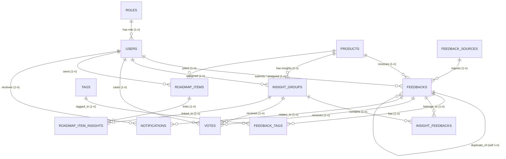

# Thiết Kế Cơ Sở Dữ Liệu (PostgreSQL) & ERD — InsightHub AI (Đã Tối Giản)

## 1. Sơ Đồ Quan Hệ Thực Thể (ERD)

---

## 2. Chi Tiết 13 Bảng Nghiệp Vụ PostgreSQL

### 2.1 `roles` (5 cột)
- **PK**: `id` (`BIGSERIAL`)
- **Columns**: `code` (`VARCHAR(32)`, UNIQUE: `ADMIN`, `PRODUCT_MANAGER`, `DEVELOPER`, `CUSTOMER_SUPPORT`, `CUSTOMER`), `name`, `description`, `permissions` (`JSONB` — danh sách mã module chức năng được bật cho vai trò).

### 2.2 `users` (12 cột)
- **PK**: `id` (`BIGSERIAL`)
- **FK**: `role_id -> roles(id)` (`ON DELETE PROTECT`)
- **Columns**: `username` (UNIQUE), `email` (UNIQUE, indexed), `password` (PBKDF2-SHA256 hash), `full_name`, `job_title`, `is_active`, `is_staff`, `is_superuser`, `last_login`, `date_joined`.

### 2.3 `products` (6 cột)
- **PK**: `id` (`BIGSERIAL`)
- **Columns**: `name`, `slug` (UNIQUE), `description`, `is_active`, `created_at`.

### 2.4 `feedback_sources` (4 cột)
- **PK**: `id` (`BIGSERIAL`)
- **Columns**: `code` (UNIQUE: `WEB_FORM`, `EMAIL`, `LIVE_CHAT`, `COMMUNITY`), `name`, `is_active`.

### 2.5 `tags` & 2.6 `feedback_tags` (4 cột & 3 cột — Quan hệ n-n)
- `tags`: `id` (PK), `name` (UNIQUE), `slug` (UNIQUE), `color`.
- `feedback_tags`: `id` (PK), `feedback_id -> feedbacks(id)`, `tag_id -> tags(id)`.
- **Unique Constraint**: `(feedback_id, tag_id)`.

### 2.7 `feedbacks` (19 cột)
- **PK**: `id` (`BIGSERIAL`)
- **FK**:
  - `author_id -> users(id)` (`ON DELETE SET NULL`)
  - `product_id -> products(id)` (`ON DELETE CASCADE`)
  - `source_id -> feedback_sources(id)` (`ON DELETE PROTECT`)
  - `assigned_to_id -> users(id)` (`ON DELETE SET NULL`)
  - `duplicate_of_id -> feedbacks(id)` (`ON DELETE SET NULL`, self-referencing)
- **Columns**: `code` (UNIQUE `FB-0001`), `title`, `content`, `ai_summary`, `sender_name`, `sender_email`, `status` (`NEW`, `REVIEWING`, `PLANNED`, `DONE`, `DUPLICATE`), `impact_level` (`LOW`, `MEDIUM`, `HIGH`, `CRITICAL`), `priority_score` (`DOUBLE PRECISION`), `similarity_score` (`DOUBLE PRECISION`), `is_duplicate_confirmed` (`BOOLEAN`), `created_at`, `updated_at`.
- **Indexes**: `(product_id, status)`, `(source_id, created_at)`, `(assigned_to_id, status)`, `(author_id, created_at)`.

### 2.8 `insight_groups` (18 cột)
- **PK**: `id` (`BIGSERIAL`)
- **FK**: `product_id -> products(id)`, `assigned_to_id -> users(id)`
- **Columns**: `code` (UNIQUE `INS-001`), `title`, `description`, `possible_causes` (`JSONB`), `ai_recommendations` (`JSONB`), `draft_customer_reply`, `volume_score`, `impact_score`, `severity_score`, `priority_score`, `priority_level` (`CRITICAL`, `HIGH`, `MEDIUM`, `LOW`), `status` (`NEW`, `REVIEWING`, `PLANNED`, `DONE`), `verification_status` (`PENDING_REVIEW`, `CONFIRMED`, `REJECTED`), `feedback_count`, `created_at`.
- **Indexes**: `(product_id, status)`, `(verification_status, priority_score)`.

### 2.9 `insight_feedbacks` (4 cột — Quan hệ n-n)
- **PK**: `id` (`BIGSERIAL`)
- **FK**: `insight_group_id -> insight_groups(id)`, `feedback_id -> feedbacks(id)`
- **Columns**: `similarity_to_centroid`.
- **Unique Constraint**: `(insight_group_id, feedback_id)`.

### 2.10 `roadmap_items` & 2.11 `roadmap_item_insights` (12 cột & 3 cột — Quan hệ n-n)
- `roadmap_items`: `id` (PK), `code` (UNIQUE `RM-001`), `product_id -> products(id)`, `owner_id -> users(id)`, `title`, `description`, `public_description`, `status` (`PLANNED`, `IN_PROGRESS`, `COMPLETED`), `visibility` (`PUBLIC`, `PRIVATE`), `quarter`, `progress_percent`, `updated_at`.
- `roadmap_item_insights`: `id` (PK), `roadmap_item_id -> roadmap_items(id)`, `insight_group_id -> insight_groups(id)`. Unique `(roadmap_item_id, insight_group_id)`.

### 2.12 `votes` (4 cột)
- **PK**: `id` (`BIGSERIAL`)
- **FK**: `user_id -> users(id)`, `feedback_id -> feedbacks(id)` (nullable), `insight_group_id -> insight_groups(id)` (nullable)
- **Unique Constraints**: `(user_id, feedback_id)` (when not null), `(user_id, insight_group_id)` (when not null).

### 2.13 `notifications` (8 cột)
- **PK**: `id` (`BIGSERIAL`)
- **FK**: `recipient_id -> users(id)`, `feedback_id -> feedbacks(id)` (nullable).
- **Columns**: `event_type`, `title`, `message`, `is_read`, `created_at`.
- **Index**: `(recipient_id, is_read, created_at)`.
